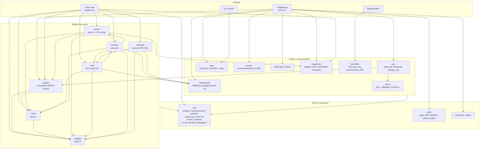

# C4 nivel 3: componentes del servidor

El servidor es **una sola app de Django** (`suno`, `server/suno/apps.py`) dividida en paquetes Python. Solo `core` y `authn` tienen migraciones; los modelos de todos los paquetes viven en `server/suno/core/models/` (una migración aditiva por pieza: `0028_costs_ledger`, `0029_contracts`, `0030_materials`…). Los demás paquetes contienen servicios, vistas y cálculo.

Regla de capas (ADR-0004): las vistas solo parsean, llaman a un servicio y serializan. La lógica vive en `services.py` y en módulos de cálculo puro sin BD. Todo acceso a datos pasa por `core.scoping.scoped_qs(ctx, Model)` ([ADR-0023](../adr/0023-scoped-qs-unica-puerta-a-los-datos.md)).

## Puntos de entrada

| Ruta | Quién | Archivo |
|---|---|---|
| `/v1/…` | App móvil (JWT Bearer, deny-by-default) | `config/api.py` (Ninja) |
| `/plataforma/…` | Personas con sesión web | `config/urls.py` → `urls.py` de cada paquete |
| `/admin/` | Administradores (sesión + TOTP, IP permitidas en Caddy) | `core/admin*.py`, `backoffice/` |
| `manage.py run_worker` | Proceso `worker` | `management/commands/run_worker.py` |
| Otros comandos | Operación | `bootstrap_demo`, `seed_control_demo`, `seed_equipment_demo`, `import_basemap`, `import_layer`, `import_xlsform`, `enroll_admin_totp` |

## Mapa de componentes

Las flechas son importaciones reales entre paquetes (sin contar pruebas). Todos dependen de `core`.

## Núcleo transversal

| Componente | Responsabilidad | Archivos clave |
|---|---|---|
| `core` | Modelos (`core/models/*`), `RequestContext` inmutable resuelto una vez por request, políticas puras `can_*`, `scoped_qs`, matriz de acceso por sección, auditoría (`AuditEvent`), redacción de secretos, rate limit en BD, plantillas y estáticos de la web. | `context.py`, `policies.py`, `scoping.py`, `access.py`, `audit.py`, `scrub.py`, `ratelimit.py` |
| `authn` | Login con Argon2id (y `django-axes`), JWT EdDSA de 15 min con dos llaves vivas para rotar, refresh `selector.verifier` hasheado por dispositivo con detección de reuso. | `services.py`, `tokens.py`, `keys.py`, `auth.py` |
| `serverinfo`, `health` | `/v1/server/info` (versión de esquema, capacidades, `server_time`); `/v1/healthz` y `/v1/readyz`. | `capabilities.py` (`SCHEMA_VERSION = 2`) |

## Campo y sincronización

| Componente | Responsabilidad | Depende de |
|---|---|---|
| `sync` | `POST /v1/sync/push` síncrono y transaccional con CAS por `version`, idempotencia por `op_uuid` (`SyncOpLog`) y `pg_advisory_xact_lock` por organización; `GET /v1/sync/pull` y `/v1/sync/bootstrap` por cursor `change_seq`; purga de tombstones. Valida cantidades y avance de tareas del registro. | `forms`, `projects`, `authn`, `serverinfo` |
| `attachments` | Puerto `BlobStore` (S3 y localfs), presign con checksum, commit verificado con `HEAD`, descarga prefirmada, GC de subidas sin confirmar, subida web de soportes (`store_upload`). | `serverinfo` |
| `forms` | Definiciones declarativas (`suno/form@1`), DSL de visibilidad sin efectos, validación de respuestas, importación XLSForm acotada. Paridad con la app por `openapi/fixtures/forms_parity.json`. | `sync` |
| `jobs` | Cola en Postgres con lease, heartbeat, reaper, `dead_letter`, periódicos por organización; `GET /v1/jobs/{id}` con salida redactada. | — |
| `privacy` | `POST /v1/consents`: prueba de la autorización del titular (Ley 1581). | — |
| `basemaps`, `layers` | Mapas base MBTiles ráster y capas GeoJSON por organización; descarga por URL prefirmada. | `attachments` (puerto) |
| `equipment` | Equipos y colecciones, ficha técnica y hoja de vida, QR, lecturas, preoperacionales, mantenimiento, combustible, transporte, informes de uso y costo horario. API para la app y vistas web. | `budgets` |
| `backoffice` | Admin aislado por organización, revisión de registros, exportación CSV/XLSX/GeoJSON/GeoPackage/PDF con `safe_cell`, derechos del titular. | `sync`, `forms`, `authn` |

## Módulo de costos

Se construyó por piezas, cada una con su spec y plan en [`plans/`](../../plans/). El cálculo no se guarda: se hace al pedir la página ([ADR-0026](../adr/0026-calculo-de-control-al-momento.md)).

| Pieza | Paquete | Responsabilidad | Spec |
|---|---|---|---|
| Etapa 1 | `projects` | Proyectos, importación del cronograma MS Project (MSPDI) en dos pasos, calendario laboral, Gantt SVG, responsables, `GET /v1/projects/tasks` para la app, % de avance desde registros validados. | `2026-10-30-costos-etapa1-cronograma-design.md` |
| 3 | `budgets` | Presupuestos por proyecto con versión contractual y vigente; ítem estable (`BudgetItem`) + valores por versión; cargos AIU/IVA (`totals.py`); importación de `.xlsx` con mapeo; comparación contractual × vigente. | `2026-11-01-costos-pieza3-presupuesto-design.md` |
| 4a / 4b | `matrix` | Árbol de ubicaciones, matriz ítem × tarea (cantidad planeada), avance por cantidades ponderado por costo, ejecutado validado; cantidades por fila con GPS y hora (4b) y catálogo de ítems para la app. | `2026-11-03-costos-pieza4-matriz-design.md`, `2026-11-09-costos-pieza4b-cantidades-design.md` |
| 5 | `control` | Valor ganado: PV, EV, SV, SPI, curva S en SVG, desglose por capítulo, tarea, ubicación e ítem, Excel. Cargador con número fijo de consultas. | `2026-11-11-costos-pieza5-control-design.md` |
| 6a | `costs` + `control/actual_cost.py` | Libro de costos (borrador → aprobado, reverso), importación Excel con vista previa firmada, costos automáticos (equipos propios y transporte); AC, CV, CPI, EAC, VAC, TCPI en Control. | `2026-11-12-costos-pieza6a-costo-real-design.md` |
| 6b | `contracts` | Subcontratos y destajos, otrosíes, actas con cantidad propuesta desde lo validado, anticipo, retención, descuentos, liquidación; el acta aprobada pasa al libro. PDF para firmar. | `2026-11-14-costos-pieza6b-contratos-design.md` |
| 6c | `materials` (PR #84, v0.20.0) | Catálogo de materiales de la organización, bodegas por proyecto, compras, salidas, devoluciones, traslados, ajustes por conteo y cortes de consumos; kárdex al promedio ponderado móvil. | `2026-11-15-costos-pieza6c-materiales-design.md` (en la rama de #84) |

Todas las páginas del módulo usan la sección **Costos** o **Presupuestos** de la matriz de acceso ([ADR-0022](../adr/0022-matriz-de-permisos-por-seccion.md)); el agente de campo recibe 404. Las decisiones que dan forma al módulo están en los ADR 0026–0036. El modelo de datos está en [`modelo-datos-costos.md`](modelo-datos-costos.md).

## Pruebas y guardias de arquitectura

- `core/tests/test_architecture.py`: falla si un servicio usa `Model.objects` sin `scoped_qs` (RD-11).
- Presupuesto de consultas (`assertNumQueries`) en push, pull, control, contratos y materiales.
- `infra/scripts/check_naming.py`: guardia contra los nombres anteriores del proyecto y del concepto (ver ADR-0024 y ADR-0025).
- Mapa de hallazgos H-01…H-21 → prueba: [`../seguridad/hallazgos-tests.toml`](../seguridad/hallazgos-tests.toml).
