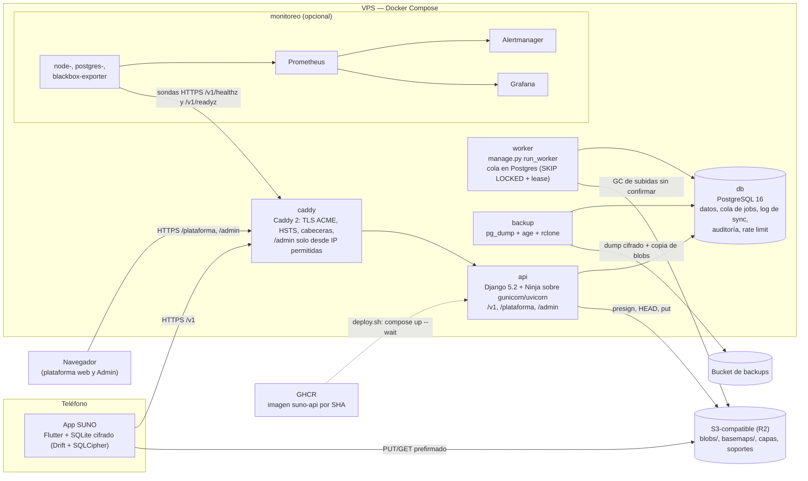

# C4 nivel 2: contenedores

Todo el servidor corre en **un VPS con Docker Compose** (ADR-0010). Los archivos están en [`infra/`](../../infra/README.md) y se combinan con `COMPOSE_FILE` en `infra/.env`:

| Archivo | Uso |
|---|---|
| `docker-compose.yml` | Base: `db`, `caddy`, `api`, `worker`, `backup`. |
| `docker-compose.override.dev.yml` | Desarrollo: puertos al host, MinIO (+ `createbuckets`) y Mailpit. |
| `docker-compose.prod.yml` | Producción: `api` y `worker` usan la imagen de GHCR fijada por digest (`SUNO_API_IMAGE`). |
| `docker-compose.monitoring.yml` | Monitoreo opcional (ADR-0014). |

## Contenedores

| Contenedor | Tecnología | Responsabilidad | Notas |
|---|---|---|---|
| `caddy` | Caddy 2 (alpine, por digest) | Borde: TLS automático, HTTP/3, HSTS, cabeceras de seguridad, sobrescribe `X-Forwarded-*` (RD-15). `/admin` responde 404 fuera de `CADDY_ADMIN_ALLOWED_IPS`. | `infra/Caddyfile`. |
| `api` | Imagen `server/Dockerfile` (Python 3.12, usuario no root, código de solo lectura) | API v1 (Ninja), plataforma web, Django Admin con MFA, estáticos con whitenoise. `entrypoint.sh` espera la BD, migra y recolecta estáticos. | `gunicorn config.asgi:application` con 3 workers `uvicorn_worker.UvicornWorker`. |
| `worker` | Misma imagen | Bucle de la cola (`suno/jobs`): toma jobs con `SKIP LOCKED`, lease y heartbeat, reaper; periódicos `queue.reap`, `sync.purge_tombstones`, `attachments.gc_unconfirmed_uploads`, `security.purge_logs`. | Sin Celery ni Redis (ADR-0006). |
| `db` | PostgreSQL 16 (sin PostGIS, ADR-0005) | Datos de negocio, cola `job`, `sync_op_log`, `audit_event`, buckets de rate limit. | Volumen `pgdata`. Sin puerto público. |
| `backup` | `postgres:16` + `age` + `rclone` | `pg_dump` periódico cifrado con llave pública, retención, copia de blobs, métrica para Prometheus. | `infra/backup/`; simulacro de restauración en CI (`backup.yml`). |
| Monitoreo | Prometheus, Alertmanager, Grafana, node-, postgres- y blackbox-exporter | Alertas probadas (`promtool test rules`); interfaces solo en `127.0.0.1` (túnel SSH). | ADR-0014, `infra/monitoring/`. |
| Desarrollo | MinIO, Mailpit | S3 local y correo simulado. | MinIO usa `latest` sin digest porque dejó de publicar imágenes (issue #21). |

## Fuera del VPS

| Contenedor | Tecnología | Responsabilidad |
|---|---|---|
| App móvil | Flutter (repo SUNO_client) | Captura sin conexión, outbox, sincronización, cola de adjuntos, mapas base offline. Ver su `docs/arquitectura/`. |
| Plataforma web | Plantillas Django servidas por `api` | No es un contenedor aparte: HTML del servidor con formularios sin JavaScript ([ADR-0020](../adr/0020-plataforma-web-con-vistas-django.md)). |
| Almacenamiento de objetos | S3-compatible (Cloudflare R2) | Blobs inmutables por `sha256` (`blobs/aa/bb/<sha256>`), mapas base (`basemaps/<sha256>.mbtiles`), capas y soportes de costos. Adaptadores `S3BlobStore` y `LocalFsBlobStore` (ADR-0007). |
| GitHub Actions + GHCR | CI y entrega | Construye `suno-api:master-<SHA>` con procedencia, la despliega por SSH ([ADR-0017](../adr/0017-despliegue-continuo-de-master.md)); `uptime.yml` vigila desde fuera cada 15 min. |

## Puertos y redes

Solo `caddy` publica puertos (80, 443 TCP/UDP). Postgres, la API y el monitoreo no se exponen. El monitoreo escucha en `127.0.0.1` del host.
