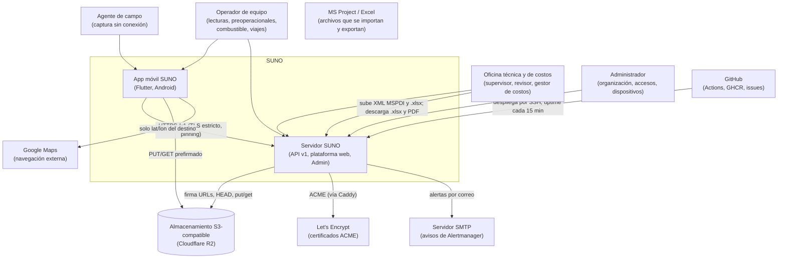

# C4 nivel 1: contexto

SUNO registra el trabajo de campo de obras (formularios, GPS, fotos, firma, cantidades ejecutadas) y, sobre esos registros, lleva el seguimiento del proyecto: cronograma, presupuesto, valor ganado y costo real.

## Personas

| Persona | Usa | Para qué |
|---|---|---|
| Agente de campo | App | Capturar registros sin conexión, con fotos, firma, GPS, avance o cantidades por ítem; ver asignaciones y mapas base. |
| Operador de equipo | App y web (`/plataforma/equipos/`) | Lecturas de horómetro, preoperacionales, combustible, viajes e informes de uso. |
| Oficina (supervisor, revisor, gestor de costos, consulta) | Plataforma web `/plataforma/` | Revisar y validar registros; cronograma, presupuestos, matriz, control (valor ganado y costo), libro de costos, contratos y actas. Lo que ve cada uno lo fija la matriz por sección ([ADR-0022](../adr/0022-matriz-de-permisos-por-seccion.md)). |
| Administrador | Django Admin `/admin/` (MFA obligatorio, IP permitidas) y `/plataforma/accesos/` | Organización, usuarios, dispositivos, plantillas, capas, mapas base, jobs y accesos. |

## Sistemas externos

| Sistema | Relación | Notas |
|---|---|---|
| Almacenamiento S3-compatible | Blobs de adjuntos (por `sha256`), soportes de costos, mapas base, capas y backups. | Producción: Cloudflare R2 (ADR-0007, ADR-0010). Desarrollo: MinIO o `localfs` (issue #21). |
| Let's Encrypt | Certificados TLS automáticos de Caddy. | |
| GitHub | CI, imágenes en GHCR con procedencia, despliegue por SSH, `uptime.yml` que abre y cierra issues `incidente`. | |
| SMTP | Alertmanager envía las alertas por correo. | La app Django no envía correo hoy. |
| MS Project, Excel | Archivos: cronograma MSPDI (XML), presupuestos, matriz, costos y catálogo de materiales (`.xlsx`). Exportaciones `.xlsx`, PDF, GeoJSON y GeoPackage. | No hay integración en línea: solo archivos. |
| Google Maps | La app abre la ruta al punto de una asignación. | Solo se envía la latitud y longitud del destino ([`c4-navegacion.md` del cliente](https://github.com/PMAPP-Org/SUNO_client/blob/master/docs/c4-navegacion.md)). |

La seguridad de cada frontera (TLS, tokens, aislamiento entre organizaciones) está en [`../seguridad/`](../seguridad/README.md) y en los ADR 0008, 0009, 0011 y 0013.
