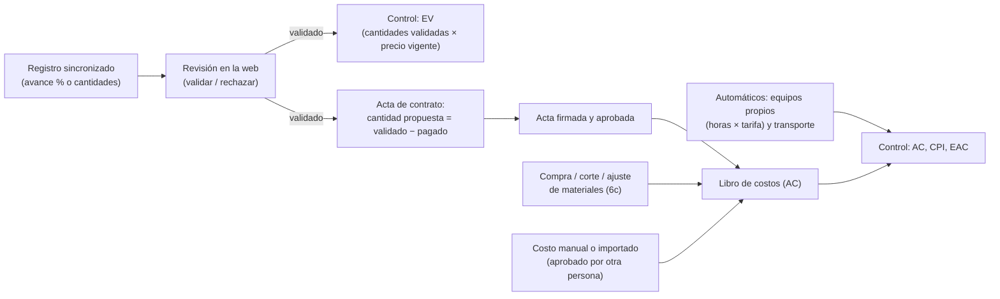

# Sincronización y flujo de datos entre la app y el servidor

La app trabaja sin conexión y sincroniza cuando hay red. El servidor es la autoridad: aplica cada cambio en la misma request y devuelve su fila si hay conflicto (ADR-0003). El contrato es [`server/openapi/v1.yaml`](../../server/openapi/v1.yaml) (OpenAPI 3.1, `info.version` 2.0.0); la app usa una copia fijada en su `contract/`.

## Carriles

| Carril | Endpoints | Qué viaja | Idempotencia |
|---|---|---|---|
| Sesión | `POST /v1/auth/login`, `/refresh`, `/logout`, `GET /v1/auth/access`, `GET /v1/server/info` | Tokens, perfil de acceso, versión de esquema y capacidades (`server_time`, límites). | Refresh rotado con detección de reuso. |
| Datos | `POST /v1/sync/push`, `GET /v1/sync/pull`, `GET /v1/sync/bootstrap` | Entidades `record`, `record_attachment` (push y pull), `assignment` y `form_template_version` (solo pull). | `op_uuid` (UUIDv7 del dispositivo) en `SyncOpLog`. |
| Adjuntos | `POST /v1/attachments/presign`, `POST /v1/attachments/{sha256}/commit`, `GET /v1/attachments/{sha256}/url` | Bytes directo al almacenamiento S3 con URL prefirmada; el API solo firma y verifica. | El `sha256` es la clave: subir dos veces el mismo archivo no duplica nada. |
| Cronograma y cantidades | `GET /v1/projects/tasks` | Tareas del agente, ítems planeados, ubicaciones y catálogo de ítems del proyecto, con `version` (`changed: false` si no cambió). | Lista completa versionada ([ADR-0037](../adr/0037-tareas-de-campo-en-endpoint-propio.md)). |
| Equipos | `GET /v1/equipment`, `POST /v1/equipment/{id}/meter-readings`, `/inspections`, `/fuel-fills`, `/usage-reports`, `GET …/life-sheet`, `GET /v1/fuel/catalog`, `GET /v1/transport/catalog`, `POST /v1/transport/trips` | Lecturas, preoperacionales, combustible, viajes e informes. | Cada envío lleva un id del cliente; la app los guarda en outboxes propias por tipo. |
| Mapas y capas | `GET /v1/basemaps`, `/basemaps/{id}/download`, `GET /v1/layers`, `/layers/{id}/download` | Mapas base MBTiles y capas GeoJSON por organización (URL prefirmada; la app reanuda con `Range` y verifica el `sha256`). | — |
| Privacidad | `POST /v1/consents` | Prueba de la autorización del titular (Ley 1581). | — |
| Jobs | `GET /v1/jobs/{id}` | Estado de un job; salida redactada y solo para administradores. | — |

Límites (`serverinfo/capabilities.py`): push de hasta 500 operaciones o 5 MiB; pull de hasta 1000 filas (500 por defecto); adjunto de hasta 25 MiB y 200 MiB por registro. `SCHEMA_VERSION = 2` y `MIN_SUPPORTED_SCHEMA_VERSION = 2`: la app anterior al renombre del concepto (esquema 1) ya no sincroniza ([ADR-0025](../adr/0025-solo-migraciones-aditivas-con-produccion.md)).

## Ciclo de sincronización

La app dispara el ciclo al abrir la pantalla de inicio, al volver al primer plano, cada 5 minutos con la app abierta y al guardar un registro; un ciclo a la vez (`SyncCoordinator` del cliente). Con la app cerrada no sincroniza todavía.

```mermaid
sequenceDiagram
    autonumber
    participant APP as App (Drift + outbox)
    participant API as api (Ninja)
    participant PG as PostgreSQL
    participant S3 as Almacenamiento S3

    Note over APP: Sin red: guardar = una transacción local<br/>(fila + operación de outbox + adjunto pendiente)

    APP->>API: POST /v1/sync/push {device_id, batch_uuid, schema_version, ops[]}
    API->>PG: BEGIN + pg_advisory_xact_lock(org)
    loop por operación (permisos ya resueltos en RequestContext)
        API->>PG: ¿op_uuid en sync_op_log? → devuelve el resultado guardado
        API->>PG: valida (formulario, tarea, cantidades, registro validado)<br/>UPSERT con CAS: version = base_version
        API->>PG: change_seq = MAX + 1 (bajo el lock)
    end
    API->>PG: COMMIT
    API-->>APP: [{op_uuid, status: applied | conflict | rejected, server_row?, reason?}]
    Note over APP: conflict o rejected → cuarentena visible<br/>("Para revisar"); nunca se descarta en silencio

    APP->>API: POST /v1/attachments/presign {sha256, size, mime}
    API-->>APP: already_present o URL prefirmada (con checksum)
    APP->>S3: PUT (bytes)
    APP->>API: POST /v1/attachments/{sha256}/commit
    API->>S3: HEAD (tamaño y checksum certificado por el almacenamiento)
    API->>PG: Blob ON CONFLICT DO NOTHING

    APP->>API: GET /v1/sync/pull?cursor=c1:…&limit=500
    API->>PG: filas con change_seq > cursor (orden estricto) + tombstones
    API-->>APP: {rows[], next_cursor, has_more}
    Note over APP,API: cursor anterior a la purga de tombstones → 409 cursor_expired → bootstrap

    APP->>API: GET /v1/projects/tasks (si el agente tiene tareas)
    API-->>APP: lista completa + version (o changed: false)
```

## Reglas que conviene saber

- **Sin merge de tres vías.** En conflicto gana el servidor; la versión del agente queda en cuarentena para que decida (enviar su versión sobre la del servidor, o quedarse con la del servidor). Cada reintento usa un `op_uuid` nuevo, porque el servidor responde a un `op_uuid` conocido con el resultado guardado.
- **Estados de una operación**: el contrato tiene `applied`, `conflict` y `rejected`. El estado `duplicate` de doc 08 §4.2 no existe: un `op_uuid` repetido devuelve su resultado original.
- **Registro validado.** Cuando la última revisión de un registro es `approved`, el push ya no puede cambiar su tarea, su % ni sus cantidades (`record_validated`) ni borrarlo ([ADR-0038](../adr/0038-registro-validado-inmutable-desde-el-push.md)). La revisión (`review_record`) toma el mismo candado de organización que el push.
- **Cantidades (4a/4b).** Viajan dentro del registro (`Record.quantities`). El servidor solo rechaza problemas estructurales (`quantities_without_task`, `item_not_in_project`, `location_outside_task`, `duplicate_client_id`); lo demás se acepta y se resalta en la revisión.
- **Adjuntos independientes.** Un registro se acepta aunque sus fotos no hayan subido; el adjunto queda pendiente y se sube en su propio carril con backoff.
- **Orden del cursor.** `change_seq` se asigna bajo `pg_advisory_xact_lock(org)` y es único entre las cuatro entidades sincronizadas, para que un pull nunca salte una fila que commitea tarde (`sync/changeseq.py`).

## Del campo a los costos



Nada de lo que la app envía llega al dinero sin una validación humana en la web: el EV usa solo registros validados y el libro solo cuenta movimientos aprobados.
