# Modelo de datos del módulo de costos (alto nivel)

Todos los modelos heredan de `OrgScopedModel` (`org_id` obligatorio, ADR-0011) y viven en `server/suno/core/models/`. Este diagrama muestra solo las entidades y relaciones que explican el módulo; los campos completos están en cada archivo y en el spec de su pieza.

```mermaid
erDiagram
    PROJECT ||--o{ TASK : "cronograma (MSPDI)"
    PROJECT ||--o{ BUDGET : "uno o varios"
    BUDGET ||--o{ BUDGET_VERSION : "contractual y vigente"
    BUDGET ||--o{ BUDGET_ITEM : "identidad estable"
    BUDGET_VERSION ||--o{ BUDGET_ITEM_VERSION : "valores por versión"
    BUDGET_ITEM ||--o{ BUDGET_ITEM_VERSION : ""
    BUDGET_VERSION ||--o{ BUDGET_CHARGE : "AIU, IVA"
    PROJECT ||--o{ LOCATION_NODE : "árbol de ubicaciones"
    TASK }o--o| LOCATION_NODE : "ubicación"
    TASK ||--o{ QUANTITY_PLAN : "matriz ítem x tarea"
    BUDGET_ITEM ||--o{ QUANTITY_PLAN : ""
    RECORD }o--o| TASK : "avance o cantidades (JSONB)"
    RECORD ||--o{ RECORD_REVIEW : "validación"
    PROJECT ||--o{ COST_ENTRY : "libro"
    COST_ENTRY }o--o{ BUDGET_ITEM : "ítem o selección"
    COST_ENTRY }o--o| BUDGET_ITEM : "capítulo"
    COST_ENTRY }o--o| TASK : "opcional"
    COST_ENTRY |o--o| COST_ENTRY : "reverso de"
    PROJECT ||--o{ CONTRACT : "subcontrato o destajo"
    CONTRACT ||--o{ CONTRACT_LINE : "ítem + tareas"
    CONTRACT ||--o{ CONTRACT_AMENDMENT : "otrosíes"
    CONTRACT ||--o{ CONTRACT_CERTIFICATE : "actas"
    CONTRACT_CERTIFICATE ||--o{ CERTIFICATE_LINE : ""
    CONTRACT_CERTIFICATE ||--o{ COST_ENTRY : "origen: acta"
    PROJECT ||--o{ WAREHOUSE : "bodegas (6c)"
    WAREHOUSE ||--o{ STOCK_BALANCE : "saldo por material"
    WAREHOUSE ||--o{ STOCK_MOVEMENT : "kárdex"
    MATERIAL ||--o{ STOCK_BALANCE : ""
    MATERIAL_PURCHASE ||--o{ COST_ENTRY : "origen: compra (6c)"
    CONSUMPTION_CUT ||--o{ COST_ENTRY : "origen: corte (6c)"
    INVENTORY_ADJUSTMENT ||--o{ COST_ENTRY : "origen: ajuste (6c)"
    WORKER ||--o{ WORKER_WAGE : "jornal con vigencia (6d)"
    PROJECT ||--o{ PROJECT_WORKER : "asignaciones (6d)"
    WORKER ||--o{ PROJECT_WORKER : ""
    PROJECT ||--o{ TIMESHEET : "planillas de tareo (6d)"
    TIMESHEET ||--o{ TIMESHEET_LINE : "trabajador x día x destino"
    WORKER ||--o{ TIMESHEET_LINE : ""
    TIMESHEET ||--o{ COST_ENTRY : "origen: planilla (6d)"
    PAYROLL_IMPORT ||--o{ PAYROLL_IMPORT_LINE : "nómina para conciliar (6d)"
```

## Por pieza

| Pieza | Modelos (archivo) | Ideas clave |
|---|---|---|
| Etapa 1 | `Project`, `ScheduleImport`, `Task`, `TaskDependency`, `Resource`, `TaskResource`, `TaskResponsible` (`project.py`); `Record.task`, `Record.progress_pct` | El cronograma se importa de MS Project en dos pasos. El % de avance sale de registros **validados**. |
| 3 | `Budget`, `BudgetVersion`, `BudgetCharge`, `BudgetItem`, `BudgetItemVersion` (`budget.py`) | Ítem estable + valores por versión: una versión nueva no rompe lo que apunta al ítem ([ADR-0028](../adr/0028-presupuesto-item-estable-y-versiones.md)). |
| 4a | `LocationLevel`, `LocationNode` (`location.py`); `QuantityPlan`, `QuantityPlanImport` (`quantity.py`); `Record.quantities` (JSONB) | Las cantidades viajan dentro del registro ([ADR-0029](../adr/0029-cantidades-dentro-del-registro.md)). |
| 5 | Ninguno | El control se calcula al pedirlo ([ADR-0026](../adr/0026-calculo-de-control-al-momento.md)). |
| 6a | `CostEntry`, `CostEntryItem`, `CostImportToken` (`cost.py`); `SectionGrant` gana la sección `COSTS` | Solo cuenta lo aprobado; lo aprobado se reversa, no se edita ([ADR-0030](../adr/0030-libro-de-costos-aprobado-y-reverso.md)). |
| 6b | `Contract`, `ContractLine`, `ContractLineTask`, `ContractCharge`, `ContractDeduction`, `ContractAmendment`, `ContractAmendmentLine`, `ContractCertificate`, `CertificateLine` (`contract.py`); `CostEntry.certificate` | El acta aprobada genera un movimiento por línea. Aprobado = firmado ([ADR-0032](../adr/0032-aprobado-es-lo-firmado.md)); la descripción del movimiento es el ítem que imprimió el acta (`CertificateLine.label`, migración 0032, #88). |
| 6c (PR #84) | `Material`, `Warehouse`, `MaterialPurchase(+Line)`, `MaterialIssue(+Line)`, `MaterialReturn(+Line)`, `MaterialTransfer(+Line)`, `InventoryAdjustment(+Line)`, `ConsumptionCut`, `StockMovement`, `StockBalance`, `MaterialImportToken` (`material.py`); `CostEntry.material_purchase`, `consumption_cut`, `inventory_adjustment` | Kárdex de movimientos + saldos guardados ([ADR-0034](../adr/0034-kardex-movimientos-y-saldos.md)), promedio ponderado móvil ([ADR-0033](../adr/0033-promedio-ponderado-movil-por-bodega.md)), un solo origen por movimiento del libro ([ADR-0031](../adr/0031-origen-unico-del-movimiento-del-libro.md)). La compra guarda el material como se registró (`MaterialPurchaseLine.material_label`, 0032) y el corte, la clave de cada destino impreso en `summary`: el libro copia esas etiquetas (#88). |
| 6d | `Worker`, `WorkerWage`, `BenefitFactor`, `ProjectWorker`, `Timesheet`, `TimesheetLine(+Item)`, `PayrollImport(+Line)`, `LaborImportToken` (`labor.py`); `CostEntry.timesheet`; `SectionGrant` gana la sección `LABOR` | Costo estimado = fracción × jornal × factor vigentes, congelado al aprobar ([ADR-0039](../adr/0039-tareo-nominal-costo-estimado-nomina-solo-se-concilia.md)); la nómina solo se concilia y una importación se puede borrar con sus líneas (#103); datos en una sección aparte ([ADR-0040](../adr/0040-seccion-mano-de-obra-separada-de-costos.md)). |

## Invariantes en la base de datos

Las reglas que no pueden romperse se escriben como `CheckConstraint`/`UniqueConstraint`, no solo en el servicio:

| Restricción | Dónde | Qué garantiza |
|---|---|---|
| `cost_entry_amount_sign` | `CostEntry` | Valor distinto de cero; negativo solo en reversos (y, desde 6c, en el neto de un corte). |
| `cost_entry_approval_ok` | `CostEntry` | Aprobado con soporte y por alguien distinto de quien registró y de quien modificó por última vez. |
| `cost_entry_rejection_note`, `cost_entry_decision_pair` | `CostEntry` | Rechazo con motivo; decisión con autor y fecha. |
| `cost_entry_reversal_approved`, `reverses` único | `CostEntry` | Un movimiento se reversa una vez y el reverso nace aprobado. |
| `cost_entry_scope_fields` | `CostEntry` | Capítulo e ítems coherentes con la asignación (`indirect`, `item`, `chapter`, `selection`). |
| `cost_entry_single_origin` (6c; 6d agrega `timesheet`) | `CostEntry` | Como mucho un documento de origen (acta, compra, corte, ajuste o planilla de tareo). |
| `worker_document_uq`, `worker_active_retired` (6d) | `Worker` | Un documento por organización; activo si y solo si no tiene fecha de retiro. |
| `timesheet_period_max_31`, `timesheet_approval_ok`, `timesheet_reverse_note` (6d) | `Timesheet` | Periodo de hasta 31 días; aprobada con la planilla firmada y por otra persona; anulada con motivo. |
| `timesheet_line_fraction`, `timesheet_line_frozen`, `timesheet_line_uq` (6d) | `TimesheetLine` | 0 < fracción ≤ 1,5; jornal, factor y valor nulos o los tres > 0; una línea por trabajador, día y destino. |
| `benefit_factor_range` (6d) | `BenefitFactor` | 1 ≤ factor ≤ 3. |
| `stock_balance_not_negative`, `stock_balance_empty_has_no_value` (6c) | `StockBalance` | Sin inventario negativo; saldo vacío sin valor. |
| `stock_movement_sequence_uq`, `stock_movement_one_origin`, `stock_movement_sign` (6c) | `StockMovement` | Orden del kárdex por par (bodega, material) y un solo documento de origen. |

## Cómo se calcula el control

`control/loader.py` lee con un número fijo de consultas (9 sin costos; 16 con costos) y pasa los datos a funciones puras: `earned_value.py` (PV, EV, SPI), `actual_cost.py` (AC directo e indirecto, CPI, EAC, VAC, TCPI) e `indices.py` (umbrales 0,95 / 0,85). El EV usa cantidades **validadas** × precio de la versión vigente, acotado a [0, planeada] por par ítem × tarea ([ADR-0027](../adr/0027-modelo-de-valor-ganado.md)).
